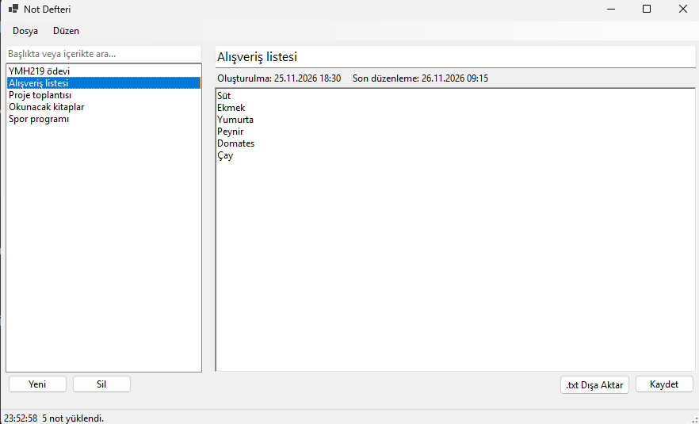
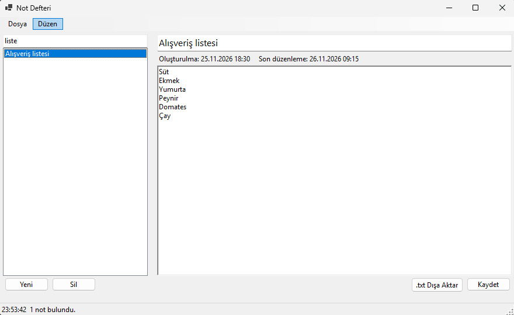

# YMH219-NotepadApp

Windows Forms ile yazılmış basit bir **Not Defteri** uygulaması. Başlık ve içerikten oluşan notları ekleyip listeleyebilir, düzenleyip silebilirsiniz. Notlar JSON olarak dosyaya kaydedilir ve uygulama açılırken otomatik yüklenir, yani uygulama kapatılıp açıldığında da korunur.

Fırat Üniversitesi, Nesne Tabanlı Programlama (YMH 219) dersi, 6. ek uygulama ödevi.

## Kullanılan Teknolojiler

- **Dil:** C#
- **Platform:** .NET 10 (`net10.0-windows`)
- **Arayüz:** Windows Forms
- **Serileştirme:** `System.Text.Json` (.NET içinde gelir)
- **Dosya işlemleri:** `System.IO` (`File`, `Directory`, `StreamReader`, `StreamWriter`)
- **Geliştirme ortamı:** Visual Studio 2026
- **NuGet paketleri:** Yok. Projede yalnızca .NET'in kendi kütüphaneleri kullanılıyor.

## Kurulum ve Çalıştırma

**Gereksinimler:** Windows ve .NET 10 SDK (veya daha yeni bir SDK).

### Visual Studio ile

1. Repoyu klonlayın:
   ```bash
   git clone https://github.com/mhmdcngz/YMH219-NotepadApp.git
   ```
2. `YMH219-NotepadApp.slnx` dosyasını Visual Studio 2026 ile açın.
3. **F5** ile (veya *Başlat* düğmesiyle) çalıştırın.

### Komut satırı ile

```bash
git clone https://github.com/mhmdcngz/YMH219-NotepadApp.git
cd YMH219-NotepadApp
dotnet run
```

## Temel Özellikler

- **Not ekleme, listeleme, düzenleme, silme:** Notlar sol taraftaki listede başlıklarıyla görünür. Seçilen notun başlığı ve içeriği sağ tarafta düzenlenebilir.
- **Tarih bilgisi:** Her notun oluşturulma ve son düzenlenme tarihi tutulur ve gösterilir.
- **Kalıcı kayıt (JSON):** Notlar `%AppData%\YMH219-NotepadApp\notes.json` dosyasına serileştirilir ve açılışta otomatik yüklenir.
- **Otomatik kaydetme:** Ekleme, düzenleme ve silme işlemlerinden sonra notlar dosyaya kendiliğinden yazılır.
- **.txt olarak dışa aktarma:** Seçilen not, başlığı, tarihleri ve içeriğiyle birlikte düz metin dosyası olarak kaydedilebilir.
- **Arama:** Notlar başlığa veya içeriğe göre filtrelenebilir.
- **Hata yönetimi:**
  - Kayıt dosyası yoksa uygulama boş bir listeyle açılır.
  - Dosya bozuksa (geçersiz JSON) kullanıcıya bilgi verilir. Bozuk dosya `notes.json.bak` adıyla yedeklenir ve uygulama boş listeyle devam eder.
  - Okuma veya yazma hataları (izin, kilitli dosya vb.) kullanıcıya mesajla bildirilir.
- **Geri bildirim:** Yapılan işlemlerin sonucu durum çubuğunda gösterilir.

## Proje Yapısı

| Dosya | Görevi |
|---|---|
| `Note.cs` | Not modeli: `Id`, `Title`, `Content`, `CreatedAt`, `UpdatedAt` |
| `NoteStorage.cs` | Notları JSON dosyasına kaydetme/yükleme ve hata yönetimi |
| `MainForm.cs` | Arayüz ve olay işleyicileri (ekle, sil, kaydet, dışa aktar, ara) |
| `Program.cs` | Uygulamanın giriş noktası |

Notlar bellekte `List<Note>` koleksiyonunda tutulur. Dosya işlemleri arayüzden ayrı bir sınıfta (`NoteStorage`) yapılır, böylece form yalnızca kullanıcı etkileşimiyle ilgilenir.

## Ekran Görüntüleri

<!-- Ekran görüntülerini docs/ klasörüne koyup aşağıdaki yolları güncelleyin. -->

### Ana ekran


### Not düzenleme / dışa aktarma


## Bilinen Sınırlamalar ve Geliştirme Notları

- Notlar yalnızca düz metin olarak saklanır. Kalın, italik gibi biçimlendirme desteği yok.
- Kategori/etiket desteği yok.
- Tüm notlar tek bir JSON dosyasında tutulur. Çok sayıda notta her kayıtta dosyanın tamamı yeniden yazılır.
- Aynı anda birden fazla uygulama penceresi açılırsa son kaydeden pencerenin verisi geçerli olur.
- Uygulama yalnızca Windows'ta çalışır (Windows Forms).

**Olası geliştirmeler:** kategori/etiket, RichTextBox ile biçimlendirme, notları tarihe göre sıralama, tüm notları tek seferde dışa aktarma.

## Geliştirici

- **Ad Soyad:** Muhammed Cengiz
- **Öğrenci Numarası:** 250541037
